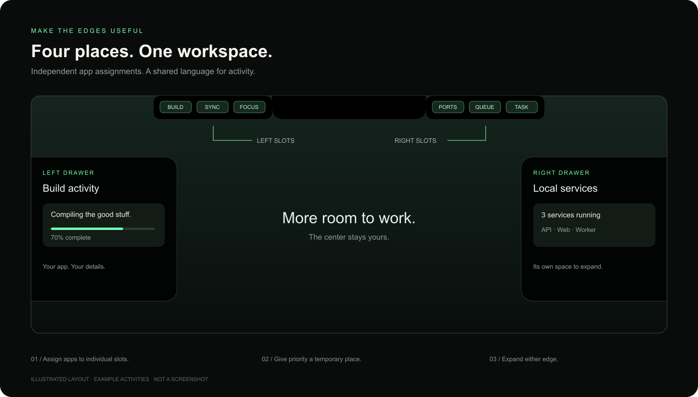
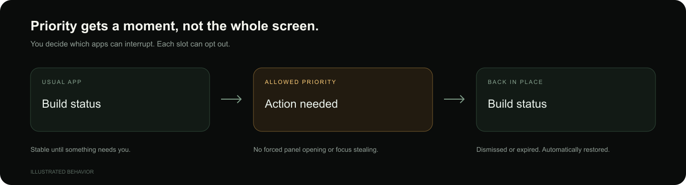

# Your apps, at the edges.

Notchwork gives app activity a home around your Mac’s notch and along either side of the screen. Keep a build in one slot, services in another, and expand a drawer when you need the details.

A native macOS app. A local integration API. A Swift package for building your own surfaces.

**Built with Notchwork:** [Portkeeper](https://github.com/jesseglab/portkeeper) brings Porty, project controls, and managed terminals to the notch. It uses the SDK for its native surfaces and supplies its own panel to the shared host.

**macOS 14+ · Swift / SwiftUI · Development preview · Noncommercial source available**

[Download v0.1.0](https://github.com/jesseglab/notchwork/releases/tag/v0.1.0) · [Get started](#get-started) · [Connect an app](#connect-an-app) · [API reference](docs/API.md) · [Contributing](CONTRIBUTING.md)

> **Live integrations:** connect Apple Music and Spotify, show real build/script results, and receive service status from the companion Portkeeper bridge. Enable the integrations you want; other apps can connect through the API or Swift SDK. [Setup guide →](docs/INTEGRATIONS.md)

> **Development release:** Apple silicon app and CLI downloads are available on the release page. They are ad-hoc signed and have not been notarized; macOS may block downloaded binaries. Building locally is also supported.

## A place for everything that’s happening



| Place | Make it yours |
| --- | --- |
| Left of the notch | Up to three slots, each assigned to an app or following activities automatically. |
| Right of the notch | Its own three slots, configured independently. |
| Left drawer | An expandable home for activity details, following the left side or one chosen app. |
| Right drawer | A separate drawer with its own app assignment. |

**Small when you’re working. Roomy when you need it.** Hover or click to expand. Activity cards can include progress, plain-text details, and web action buttons. Disable the drawers or slots you don’t need.

## The important things get a turn



Normal, important, and urgent activities share a predictable queue. Enable priority for the apps you trust; each slot can still refuse interruptions. An allowed alert takes a temporary place, then gives it back when dismissed or expired.

Priority does not force a panel open, take keyboard focus, or run an action.

## Get started

You need macOS 14 or later and Xcode’s Swift toolchain. The current build has been tested on Apple silicon. Intel builds are not yet verified.

```sh
git clone https://github.com/jesseglab/notchwork.git
cd notchwork
zsh build.sh
open dist/Notchwork.app
```

In the control room, enable **Apple Music**, **Spotify**, or the **Portkeeper** bridge and assign your slots. For builds, use the command wrapper below. **Load examples** remains available to try the layout with clearly labeled sample data. The menu bar icon brings configuration back whenever you need it. [Connect your apps.](docs/INTEGRATIONS.md)

The build produces `dist/Notchwork.app`, `dist/Notchwork.zip`, and `dist/notchworkctl`, plus checksums and license notices. No security-setting changes are required by these local build instructions.

## Connect an app

### Real builds and scripts

Wrap a command to show its running state and actual result. Output stays in your terminal; failures can request priority.

```sh
./dist/notchworkctl run --name "Web build" -- npm run build
./dist/notchworkctl run --name "Tests" -- swift test
```

The command runs normally even if Notchwork is closed. [Behavior and signal handling.](docs/INTEGRATIONS.md#builds-and-scripts)

### Custom activities

With the host running:

```sh
./dist/notchworkctl ping
./dist/notchworkctl publish Examples/build.json
./dist/notchworkctl remove com.example.builder build-main
```

Use the [Python example](Examples/publish.py), the command-line client, or send JSON over the local HTTP API. Publishing the same source and activity IDs updates the existing card. Give activities a lifetime so disconnected integrations don’t leave stale items behind.

### From Swift

Add `https://github.com/jesseglab/notchwork.git` as a Swift package dependency, select version **0.1.0** and the **NotchworkKit** product.

```swift
import NotchworkKit

let client = try NotchworkClient()
try await client.publish(NotchActivity(
    id: "build",
    sourceID: "com.example.builder",
    sourceName: "Builder",
    title: "Building · 64%",
    symbol: "hammer.fill",
    preferredSide: .left,
    progress: 0.64,
    ttl: 60
))
```

Want your own native view instead? Embed `LiquidSurfaceView` in an `NSPanel`. The package supports notch, left-drawer, and right-drawer surfaces with custom SwiftUI content. [See the native example.](Examples/EmbeddedSurface.swift)

Your app keeps its own visuals, layout, and behavior. **Native apps** supply their own SwiftUI views and closures to the SDK. **Shared-host integrations** can supply an offline HTML/CSS/JavaScript panel, a PNG icon, and named actions delivered back to their app. Custom panels require per-app permission in the control room; standard cards remain the fallback. [Build a custom interface.](docs/CUSTOM_INTERFACES.md)

Arbitrary native views run in their owning app through the SDK; they are not loaded as plugins into the shared host. Commercial use of the app or SDK requires separate permission.

## Motion with a light footprint

The same spring-driven engine powers all three surfaces. Hover reversals preserve momentum; a stationary window canvas keeps content stable while its mask changes shape. Reduced Motion applies the final layout immediately.

Closed content is detached from its window. Updates are coalesced, hover handling is event-driven, and expiry uses the next deadline instead of continuous polling. No continuous idle animation is added by the host. Actual resource use depends on activity volume and connected apps.

## Local by design

The host binds to `127.0.0.1`, uses a per-launch integration token, and limits request size and active connections. Activities are kept in memory; layout preferences persist on this Mac. The client refuses redirects and remote endpoints. Browser-origin requests are rejected.

The token grants access to the whole host. Source IDs are app-supplied labels, **not verified app identities**. Use trusted local integrations. [Read the security model.](SECURITY.md)

## Build something with it

- [Integration protocol and limits](docs/API.md)
- [How the host and framework fit together](docs/ARCHITECTURE.md)
- [Build, test, and contribute](CONTRIBUTING.md)
- [Current release notes](CHANGELOG.md)
- [Release checklist and signing](docs/RELEASING.md)

Apple Music, Spotify, the Portkeeper bridge, and build/script status are included. Verified app pairing, monitor selection, and launch at login are future work. There is no extension marketplace; unsupported apps still need an integration.

## License

[PolyForm Noncommercial 1.0.0](LICENSE). You may use, modify, and share the software for the purposes permitted by the license. **Commercial use is not granted.** Contact [the maintainer](https://github.com/jesseglab) for separate commercial permission.

This is **source-available software**, not OSI-approved open source. The app and SDK use the same terms. Preserve the [required notice](NOTICE) when redistributing.

---

Made for the little things you want to keep in view.
