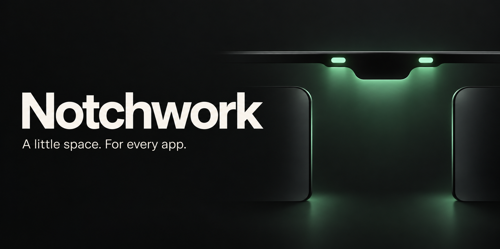
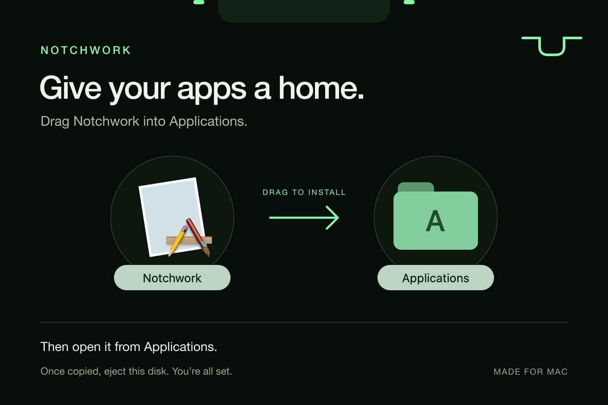

# A little space. For every app.

Notchwork gives app activity a home around your Mac’s notch. Keep it small while you work, then expand the morphing container when you need the details.

A small macOS background app. A local integration API. Settings for the apps you want to keep in view. Your app supplies its own content, branding, controls, and actions; Notchwork supplies the shared container.

**Built with Notchwork:** [Portkeeper](https://github.com/jesseglab/portkeeper) brings Porty, project controls, editors, handoff tools, and managed terminals to the notch. It installs Notchwork if needed and uses the API for all of its notch UI.

**macOS 14+ · Swift / SwiftUI · Development preview · Noncommercial source available**

[Download v0.2.1](https://github.com/jesseglab/notchwork/releases/tag/v0.2.1) · [Get started](#get-started) · [Connect an app](#connect-an-app) · [Copy an LLM prompt](docs/LLM_PROMPTS.md) · [API reference](docs/API.md) · [Releases](https://github.com/jesseglab/notchwork/releases)

> **Downloadable development preview:** Notchwork **0.2.1, build 10**, with API 2 is available for Apple silicon. [Download the DMG](https://github.com/jesseglab/notchwork/releases/download/v0.2.1/Notchwork-0.2.1-arm64-development.dmg) or [ZIP](https://github.com/jesseglab/notchwork/releases/download/v0.2.1/Notchwork-0.2.1-arm64-development.zip). No source build is needed. These binaries are ad-hoc signed and have not been notarized; macOS may block them on first launch.

## A place for everything that’s happening

| Mode | Make it yours |
| --- | --- |
| One | One selected app uses the whole container, with all of its controls. |
| Two | One app on the left and one on the right, with fixed assignments. |
| Multiple | Two visible apps, selected by high, mid, or low priority and the newest meaningful update. |

**Small when you’re working. Roomy when you need it.** The collapsed container follows the physical camera notch, with padded app icons at its sides. Titles and controls appear when expanded. Displays without a camera notch use a small top-center handle.

Hover the left icon to open the left app’s full interface, or the right icon for the right app. Moving away closes it again; use the pin button when you want it to stay open.

Choose the mode in settings and enable the apps and custom interfaces you want. Notchwork has no built-in Music, Spotify, or Portkeeper adapters: apps connect through the same API.

## The important things get a turn

In Multiple mode, high-priority updates appear before mid and low. New meaningful updates break ties; unchanged heartbeats do not reshuffle the apps. When an issue resolves, the client lowers its priority, removes the activity, or lets it expire.

One and Two keep your assignments fixed. Priority never forces the container open or takes keyboard focus. An app opens its interface in response to your explicit action.

## Get started

### Install with drag and drop

[Download the Apple silicon DMG](https://github.com/jesseglab/notchwork/releases/download/v0.2.1/Notchwork-0.2.1-arm64-development.dmg). The [release page](https://github.com/jesseglab/notchwork/releases/tag/v0.2.1) also includes a ZIP and SHA-256 checksums.

1. Download the DMG and open it.
2. Drag **Notchwork** onto **Applications** in the installer window.
3. Eject the disk, then open **Notchwork** from Applications.



*Illustrated installer layout. Finder icons and colors follow your macOS appearance.*

The DMG is a drag-and-drop installer; it does not run scripts or start services. This development app is ad-hoc signed and not notarized, so macOS may block it on first launch. Packaging it as a DMG does not change that signing status.

### Build from source

You need macOS 14 or later and Xcode’s Swift toolchain. The current build has been tested on Apple silicon. Intel builds are not yet verified.

```sh
git clone https://github.com/jesseglab/notchwork.git
cd notchwork
zsh build.sh
open dist/Notchwork.app
```

The menu-bar icon opens settings. Choose One, Two, or Multiple, then connect an app using the examples below. An app such as Portkeeper can also install the matching runtime for you. [Connect your apps.](docs/INTEGRATIONS.md)

The build produces `dist/Notchwork.app`, `dist/Notchwork.zip`, and `dist/notchworkctl`, plus checksums and license notices. No security-setting changes are required by these local build instructions.

## Connect an app

### Try a working example

With the host running, use Python 3.9+ to check the connection and publish an example:

```sh
python3 scripts/doctor.py
python3 Examples/publish.py Examples/build.json --present
```

If the runtime is still starting, run the doctor again. `--present` is your explicit request to open the example; normal background updates never open the notch. The card expires automatically.

Try [interactive controls](Examples/interactive.py):

```sh
python3 Examples/interactive.py --present
```

Click **Acknowledge** in the notch. The Python process receives the event, updates its own state, and republishes. Stop it with Ctrl-C, or restart Notchwork while it runs to see reconnection.

### From Swift

```swift
import NotchworkKit

let client = try NotchworkClient()
let host = try await client.ping() // Require apiVersion >= 2.
try await client.register(.init(id: "com.example.app", name: "My App"))
try await client.publish(NotchActivity(
    id: "status", sourceID: "com.example.app", sourceName: "My App",
    title: "Ready", priority: .low, ttl: 60
))
```

[Run the complete Swift package](Examples/HelloNotch/README.md), or follow the [SwiftPM setup](docs/QUICKSTART.md#add-to-a-swift-app). The linked library is the API client; the shared runtime must also be running.

Your app keeps its own visuals, layout, and behavior. Supply an offline HTML/CSS/JavaScript interface and named actions delivered back to your app. Custom interfaces respect per-app permission in settings. [Build a custom interface.](docs/CUSTOM_INTERFACES.md)

The Swift package provides the API client; the shared background runtime owns the window. Clients do not create a separate notch panel. See [the integration lifecycle](docs/DEVELOPERS.md) and [bundling the runtime](docs/DISTRIBUTION.md).

## Motion with a light footprint

The spring-driven engine powers the shared morphing container. Hover reversals preserve momentum; a stationary window canvas keeps content stable while its mask changes shape. Reduced Motion applies the final layout immediately.

Closed content is detached from its window. Updates are coalesced, hover handling is event-driven, and expiry uses the next deadline instead of continuous polling. No continuous idle animation is added by the host. Actual resource use depends on activity volume and connected apps.

## Local by design

The host binds to `127.0.0.1`, uses a per-launch integration token, and limits request size and active connections. Activities are kept in memory; layout preferences persist on this Mac. The client refuses redirects and remote endpoints. Browser-origin requests are rejected.

The token grants access to the whole host. Source IDs are app-supplied labels, **not verified app identities**. Use trusted local integrations. [Read the security model.](SECURITY.md)

## Developer toolbox

| Need | Start here |
| --- | --- |
| First working integration | [Quickstart](docs/QUICKSTART.md) |
| Have an LLM implement it | [Copyable task prompts](docs/LLM_PROMPTS.md) / [plain-text context](llms.txt) |
| Know exactly what to send | [API](docs/API.md) / [JSON Schema](docs/command.schema.json) |
| App-designed controls | [Custom interfaces](docs/CUSTOM_INTERFACES.md) / [interactive example](Examples/interactive.py) |
| Production lifecycle | [Developer guide](docs/DEVELOPERS.md) |
| Install Notchwork with your app | [Distribution guide](docs/DISTRIBUTION.md) |
| Diagnose a hidden card or failed connection | [Troubleshooting](docs/TROUBLESHOOTING.md) / [doctor](scripts/doctor.py) |
| Contribute or report a bug | [Contributing](CONTRIBUTING.md) / [issue templates](.github/ISSUE_TEMPLATE) |

## Build something with it

- [How the host and framework fit together](docs/ARCHITECTURE.md)
- [Build, test, and contribute](CONTRIBUTING.md)
- [Current release notes](CHANGELOG.md)
- [Release checklist and signing](docs/RELEASING.md)

API 2 uses the `/v1/activity` route; discover compatibility through `ping.apiVersion` and capabilities. Pin a tested commit for your app. Older release tags do not provide this contract.

Verified app pairing, monitor selection, and launch at login are future work. There is no extension marketplace; each app supplies its own integration.

## License

[PolyForm Noncommercial 1.0.0](LICENSE). You may use, modify, and share the software for the purposes permitted by the license. **Commercial use is not granted.** Contact [the maintainer](https://github.com/jesseglab) for separate commercial permission.

This is **source-available software**, not OSI-approved open source. The app and SDK use the same terms. Preserve the [required notice](NOTICE) when redistributing.

---

Made for the little things you want to keep in view.
