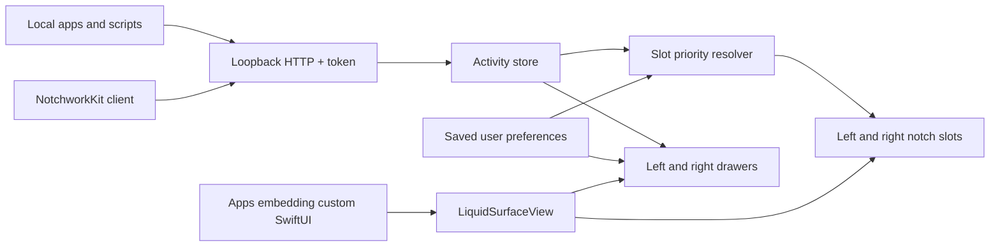

# Architecture

`NotchworkKit` contains the Codable activity model, validation, deterministic slot resolver, native surface engine, and asynchronous HTTP client. It has no external package dependencies.

`NotchworkHost` owns the menu bar item, control room, panel geometry, live activity store, saved assignments, and bounded loopback server. The host can show cards from any trusted local process that speaks the protocol.

`notchworkctl` is a small client for scripts. It uses the same Swift client path as native integrations.

The two integration paths are distinct: the shared host receives JSON cards; an embedded surface can display any SwiftUI content in the integrating app's own process. Multiple applications should not independently claim the same screen area.

## Scheduling

Network I/O uses a serial utility queue. Validated commands are applied on the main actor. Activity publications coalesce at 100 ms. One timer tracks the next expiry. The spring display driver runs during surface transitions and stops at rest. Hidden expanded hosting views detach after collapse.

## Pointer interaction

Use `surface.containsHoverPoint(point, expanded: isOpen)` for hover decisions. Closed surfaces activate only inside the compact notch or drawer handle, including during a closing animation. Open surfaces retain their visible interaction area. Hidden windows never activate. `containsScreenPoint` remains the visible-shape hit test for click pass-through; it is not an opening trigger.

## Current boundaries

The host chooses the first screen with a hardware notch, otherwise the main screen. This is a top-center surface on displays without a notch, not a way to render through the physical camera area. Monitor selection and per-display layout are future work.

Slots support up to three entries per side. The source registry is capped at 32 and the live store at 128. A source-management UI for forgetting old registrations is not implemented yet.

## Live adapters

`Integrations` owns optional player adapters and the Portkeeper directory watcher. `MusicAdapter` uses each player’s public scripting dictionary on a serial utility queue; workspace launch/quit events suspend polling while the player is closed. `ActivitySnapshot` validates identity and freshness before the Portkeeper bridge enters the normal activity store. Both paths share the existing priority resolver. The command wrapper lives in the CLI process and sends status over the same local API. See [integration setup](INTEGRATIONS.md).
