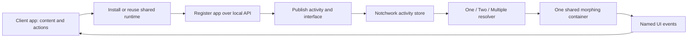

# Architecture

`NotchworkKit` defines the activity, registration, event and client APIs, validation, layout selection, and morphing primitives. `NotchworkHost` owns the single notch window, renderer, settings, and loopback server. There are no built-in app adapters.

Client applications own process management, state, application content, and actions. The host only renders a supplied interface and queues declared actions back to the originating client. Portkeeper installs or reuses the shared host and never creates a notch or edge surface of its own.

Notifications affect compact selection only in Multiple mode. An explicit user-triggered `present` temporarily opens a particular app full-width; collapse restores the configured layout. Source disabling and interface permissions apply to both paths.

Live state is held in memory. Settings persist. Publications coalesce at 100 ms, one timer tracks expiry, and the spring driver runs only during transitions. A client reconnects by discovering the new token, registering, and republishing its current state.

The host chooses the first notched display, otherwise the main display. The source registry is capped at 32 and the live store at 128. The loopback token grants whole-host access, not verified per-app identity.
